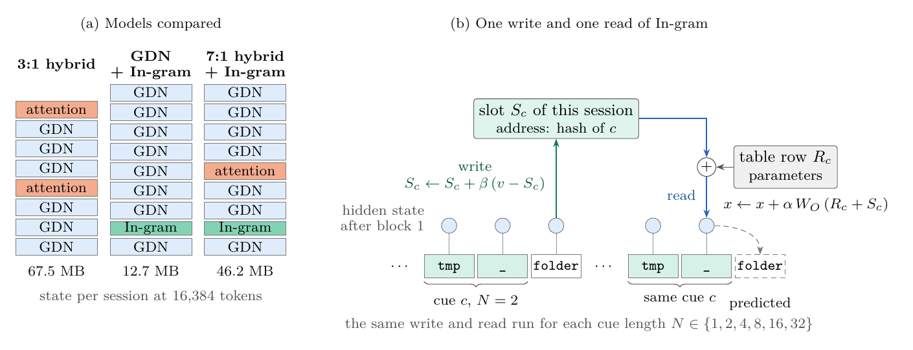
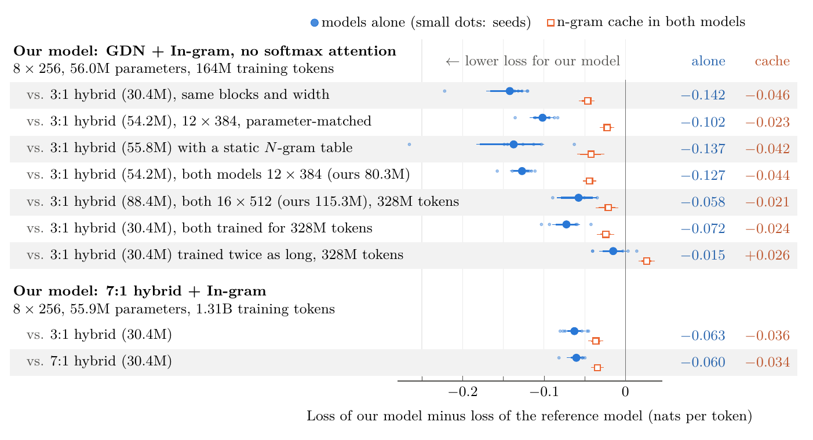

# In-gram: In-Context N-gram Memory

Paper, reference implementation and full reproduction package for **In-gram**, a memory layer that lets a
hybrid language model reach lower loss with fewer softmax-attention layers.

Paper: [`paper/in-gram.pdf`](paper/in-gram.pdf), "In-gram: In-Context N-gram Memory for Hybrid Language Models
with Fewer Attention Layers" (Keston Aquino-Michaels, No Way Labs, 2026).



## What it is

Recent open hybrid language models mix linear-attention and softmax-attention layers at ratios up to 7:1, and
the cache of the softmax-attention layers grows with the context. One role of those layers is to recall earlier
text verbatim, and in software-agent sessions most tokens repeat something that came before.

In-gram performs that recall with a lookup inside the model. Each time an N-gram occurs, the layer writes a
note into a slot addressed by the hash of that N-gram, and the next time the same N-gram occurs the layer reads
the note back, together with a learned table row for the same address. It does this for six N-gram lengths
(1, 2, 4, 8, 16 and 32 tokens) at a cost of one read and one write per length for each token, whatever the
length of the context. Because the addresses depend on token ids alone, the schedule of writes and reads is known
before the forward pass, and training runs in parallel over the sequence.

## Results in the paper

All models are small (30M to 115M parameters) and are trained and evaluated on 16,384-token contexts of
SWE-rebench agent trajectories. Every comparison below was registered before its runs and uses eight seeds.

| Comparison, at equal training steps | Loss (nats per token) | Difference |
|---|---|---|
| GDN + In-gram with no softmax attention, against a parameter-matched 3:1 hybrid (164M training tokens) | 0.607 against 0.709 | -0.102, 8 of 8 seeds |
| 7:1 hybrid + In-gram against a 3:1 hybrid (1.31B training tokens) | 0.448 against 0.510 | -0.063, 8 of 8 seeds |
| 7:1 hybrid + In-gram against a 7:1 hybrid (1.31B training tokens) | 0.448 against 0.508 | -0.060, 8 of 8 seeds |

In-gram's state in these models is 2.8 times smaller than the cache of a single softmax-attention layer after
16k tokens of a session, and 6.0 times smaller after 131k.



The paper does not test models above 115M parameters or contexts above 16,384 tokens, and it reports loss, not
retrieval benchmarks. Whether a larger hybrid keeps its long-context retrieval with fewer attention layers and
In-gram is the first open question it names.

## Install

```bash
pip install -e .          # numpy and torch
pip install -e '.[dev]'   # adds pytest
pytest
```

## Use

```python
import torch
from ingram import InGram, InGramDecoder

layer = InGram(d_model=256)              # cue lengths 1, 2, 4, 8, 16, 32; slots of width 64

# Training: the schedule comes from the token ids, the hidden states from the block before the layer.
tokens = torch.randint(0, 50_000, (2, 4096))
x = torch.randn(2, 4096, 256)            # hidden states after block 1 in the paper's models
schedule = layer.schedule(tokens)
y = layer(x, schedule)                   # x plus the gated read; pass y to the next block

# Decoding: one read and one write per cue length for each new token.
decoder = InGramDecoder(layer)
for t in range(16):
    y_t = decoder.step(x[0, t], int(tokens[0, t]))
print(decoder.n_slots, "slots,", decoder.state_bytes() / 1e6, "MB")
```

In the paper the layer sits once, after the first block of a Gated DeltaNet model or hybrid. `InGram(...,
writes=False)` gives the static hashed N-gram table that the paper uses as a control. Token ids that no cue
should contain, such as padding or a separator between documents, go in `boundary_ids`.
[`examples/quickstart.py`](examples/quickstart.py) runs the parallel pass and the decoder on the same input and
prints their difference.

## How it works

For each cue length N and each position:

- **Write.** The slot of the N-gram that ends one position earlier receives a note computed from the current
  hidden state, `S <- S + beta * (v - S)` with `v = W_v x` and `beta = sigmoid(w x + b)`. The note therefore
  describes the token that followed the N-gram.
- **Read.** The layer takes the slot `S` and the learned table row `R` of the N-gram that ends at the current
  position, and a slot that has not been written reads as zero with a flag set.
- **Inject.** The six reads are concatenated into `m`, and the layer adds `alpha * W_O m` to the hidden state,
  where `alpha = sigmoid(<norm(x), norm(W_K m)> / sqrt(d))` is a learned gate.

The slot is keyed by a 61-bit hash of the N-gram, and the table row by a second hash reduced to the number of
rows. Training sorts the writes by slot and position on the CPU and computes the state after every write with a
parallel prefix scan, which gives the same states as executing the writes one by one.

## Reproducing the paper

[`research/`](research/README.md) holds everything behind the paper's numbers, and its README gives the steps
for three levels of reproduction:

1. **Regenerate every number from the logs.** The repository includes the log and the per-token losses of all
   199 training runs. Two scripts turn them into every table and figure of the paper, byte for byte, in under a
   minute and without a GPU.
2. **Recompute the data statistics.** The scripts download and tokenize the public dataset and recount the
   repeats and the slots.
3. **Retrain any run.** Each run has its exact configuration in `research/configs/runs/`, and
   `research/run.py` trains and evaluates it on one GPU. A run of the main comparison takes 20 to 30 minutes on
   an RTX 4090, and the longest runs 2.1 to 3.6 hours.

## What is in this repository

| Path | Contents |
|---|---|
| `ingram/` | A short reference implementation of the layer: `layer.py`, the addresses (`hashing.py`), the write and read schedule (`schedule.py`), the scan (`scan.py`) and a token-by-token decoder (`decode.py`) |
| `tests/`, `examples/` | Tests of the reference implementation, and a script that runs its parallel pass and its decoder on the same input |
| `research/` | The code that produced the paper, the configuration, log and per-token losses of every run, the analysis scripts, and the reproduction guide |
| `paper/` | The PDF, its LaTeX source, and the generated tables and figure data |
| `preregistration/` | The pre-registration files of the confirmatory comparisons, with their commit times |

The reference implementation in `ingram/` was checked numerically against the research code that produced the
paper's results: with identical weights, the two agree to within 1e-13 in double precision, with the
in-context writes on and off. The models in the paper use Gated DeltaNet from the
[flash-linear-attention](https://github.com/fla-org/flash-linear-attention) library.

## Contact

Questions, corrections and results from larger models are welcome, by email to kestonamichaels at gmail.com
or as an issue on this repository.

## Citation

```bibtex
@misc{aquinomichaels2026ingram,
  title  = {In-gram: In-Context N-gram Memory for Hybrid Language Models with Fewer Attention Layers},
  author = {Aquino-Michaels, Keston},
  year   = {2026},
  note   = {No Way Labs},
  url    = {https://github.com/no-way-labs/in-gram}
}
```

## Licence

The code in `ingram/` and `research/` is released under the MIT licence ([`LICENSE`](LICENSE)). The paper, its
figures, the files in `paper/` and `preregistration/`, and the run logs and results in `research/runs/` and
`research/results/` are released under CC BY 4.0 ([`paper/LICENSE`](paper/LICENSE)).
